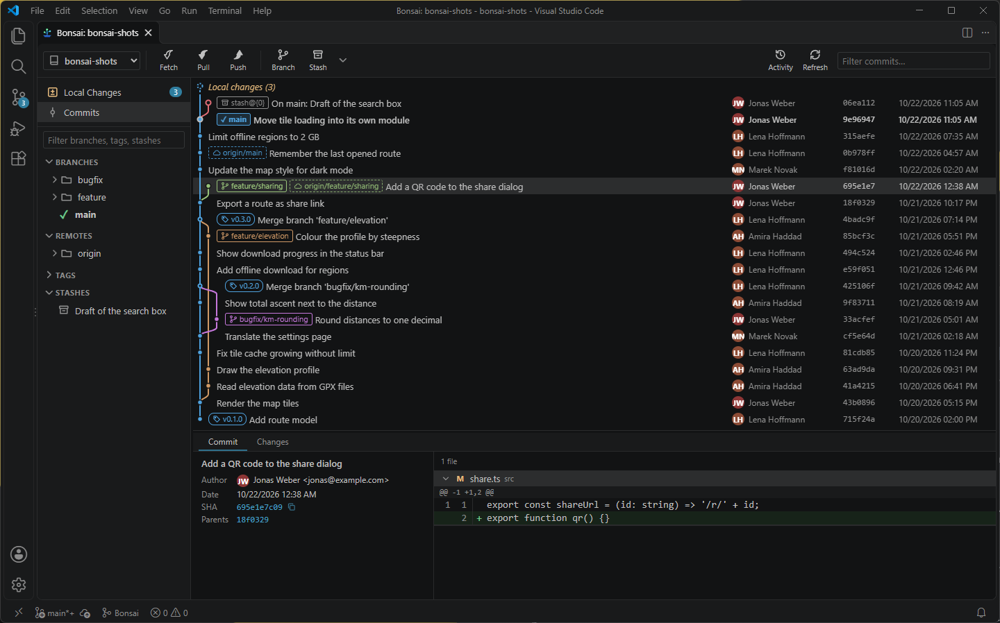
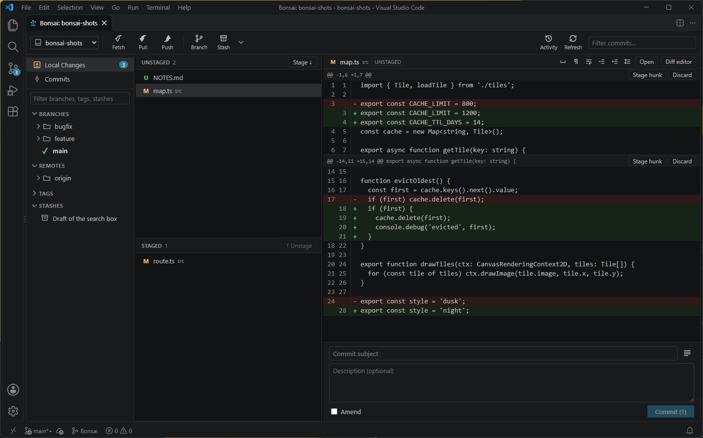
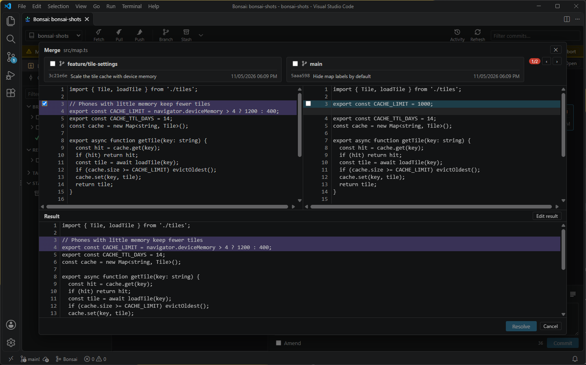

# Bonsai

A full Git client in a VS Code tab. See your whole history as a graph, stage single lines, resolve conflicts side by side and rebase interactively, without leaving the editor or typing a Git command.

## Getting started

1. Install Bonsai. It isn't on the Marketplace yet, so install the `.vsix` file: run **Extensions: Install from VSIX…** from the Command Palette and pick `build/bonsai-git-0.1.0.vsix`.
2. Open a folder that contains a Git repository.
3. Click **Bonsai** in the status bar at the bottom left. The button at the top of the Source Control view and the command **Bonsai: Open Bonsai** do the same.

With several repositories in the workspace, the dropdown at the top left switches between them.

## What you can do

### Follow the history

The graph shows every branch, remote branch, tag and stash in one view. Click a commit to see its changed files and diffs. Type in the filter box to find a commit by its message, author or hash: older commits load as you search, and Enter jumps to the next match.

The sidebar lists branches, remotes, tags and stashes as folders, so `feature/login` sits inside `feature`. Right-click almost anything for what you can do with it.

### Stage exactly what you want

Open **Local Changes** to see unstaged and staged files next to the diff. Stage or discard a whole file, one hunk, or only the lines you selected. Then write your message below and commit, or tick **Amend** to change the last commit.

### Resolve conflicts

When a merge, cherry-pick, revert, rebase or stash stops on a conflict, a banner tells you how many files are left. The merge dialog shows both sides with the result below: tick the side you want for each conflict, or both, or edit the result by hand. If you prefer VS Code's merge editor, it's one click away.

Before you start a merge, cherry-pick or revert, Bonsai does a dry run and names the files that would conflict.

### Rewrite history

- **Interactive rebase:** pick, reword, squash, fix up, drop or reorder commits in a dialog. Git never opens an editor.
- **Rebase, merge, cherry-pick, revert and reset** from the context menu of a commit or branch.
- **Drag a branch** onto another one to merge or rebase. This works when one of the two is the current branch.
- **Stashes:** save, apply, rename and delete them, and look inside before applying. To put away only some files, select them in Local Changes and right-click.

### Stay in sync

Fetch, Pull and Push sit in the toolbar, and each branch shows how far it is ahead of or behind its upstream.

Push asks first: which branch, where to, whether to track it, push all tags or force (with lease). If the push creates the remote branch and the server has something to say, Bonsai shows it afterwards, so the link GitLab or GitHub prints for a new merge or pull request is one click away.

Pushing uses your Git credentials, such as the Git Credential Manager or an SSH key. If Git can't sign in by itself, Bonsai falls back to VS Code's sign-in; the server's answer isn't shown then.

### See what happened

**Activity** in the toolbar lists what Bonsai did in this session, with the Git commands it ran and what they printed. That helps when a step ends differently than you expected.

## Settings

| Setting | Default | What it does |
|---|---|---|
| `bonsai.maxCommits` | `1000` | How many commits are loaded at a time. Scrolling to the end of the list loads the next batch. |
| `bonsai.gravatar` | `false` | Shows Gravatar pictures instead of initials. See [Privacy](#privacy). |

Automatic fetching follows VS Code's own `git.autofetch` setting.

## Requirements

- VS Code 1.90 or newer with its built-in Git extension enabled, and Git installed
- A trusted workspace: Bonsai stays off in Restricted Mode

Bonsai speaks English and German and follows the language of VS Code.

## Privacy

Bonsai talks to nothing but your Git remotes. Author pictures are initials on a coloured circle, generated locally.

If you turn on `bonsai.gravatar`, Bonsai sends a SHA-256 hash of each author's email address to gravatar.com, and the page loads pictures from there. This is off by default.

## About the name

The layout follows [Fork](https://git-fork.com), a desktop Git client. Bonsai is an independent project and has no connection to Fork or its authors.

## License

[MIT](LICENSE)

Want to build it yourself? See [docs/DEVELOPMENT.md](docs/DEVELOPMENT.md).
